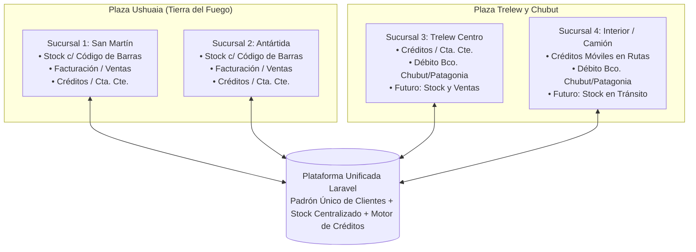
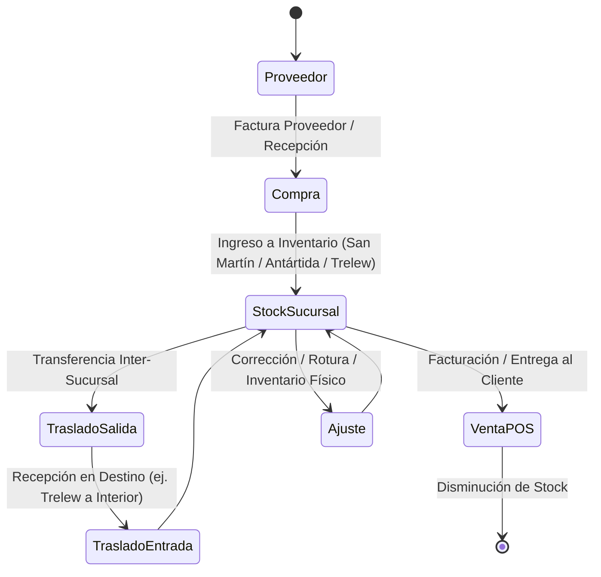
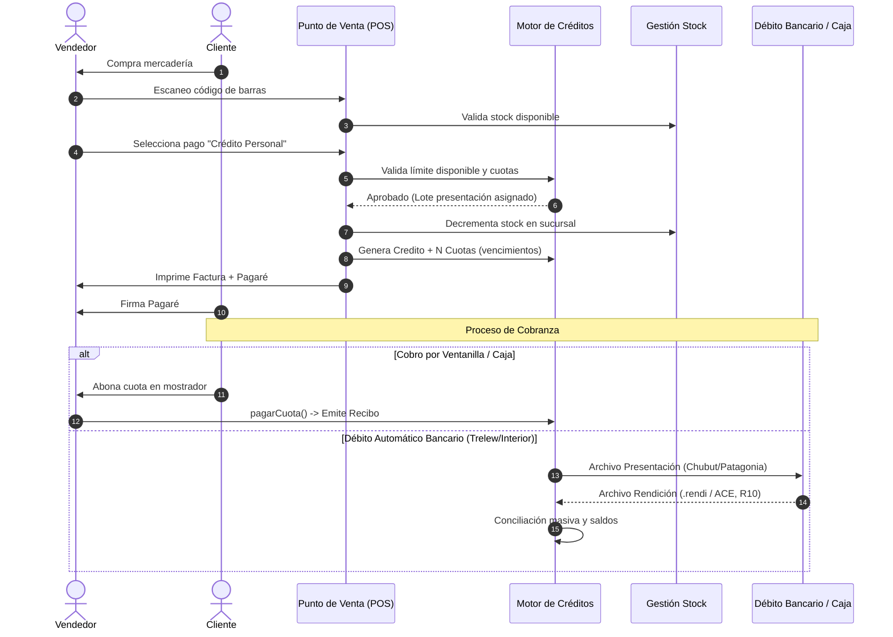
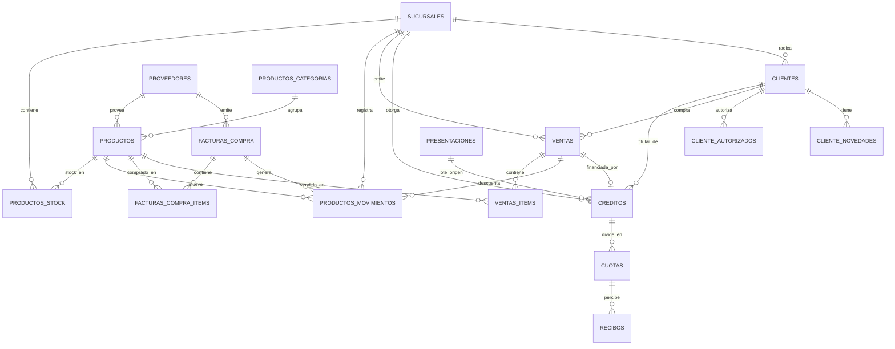
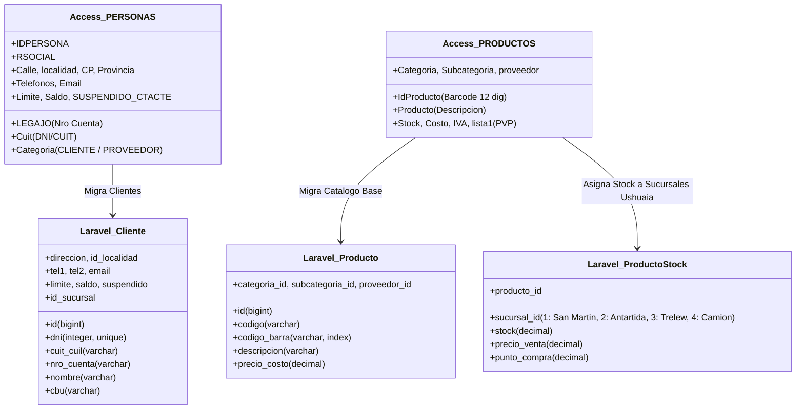

# Documento de Requerimientos de Software: Plataforma Unificada "La Marina"

**Versión:** 1.0  
**Fecha:** 15 de Octubre de 2026  
**Estado:** Propuesta de Especificación Funcional y Técnica para Unificación  
**Sistemas de Origen:**
1. `lamarina2` (Sistema legado PHP/MySQL - Trelew e Interior)
2. Sistema de Tercero con base Microsoft Access (Ushuaia San Martín y Antártida)
3. Prototipo `laravel/app` (Módulo Stock, Productos y Código de Barras - 2025)
4. Prototipo `laravel/creditos` (Módulo Créditos, Cuotas, Clientes y Auditoría - 2026)

---

## 1. Visión General del Negocio y Alcance

**La Marina** es una empresa comercial con presencia en dos plazas estratégicas (Tierra del Fuego y Chubut) que opera bajo un modelo de retail con financiamiento propio (créditos personales en cuenta corriente y cobranza por débito bancario).

El objetivo de este proyecto es **unificar en una única plataforma web moderna basada en Laravel** todas las operaciones de las 4 sucursales, consolidando el control de stock en tiempo real, la facturación comercial, las compras a proveedores y la cartera de créditos.

### 1.1 Mapa de Sucursales y Capacidades Operativas

### 1.2 Matriz Comparativa de Sistemas Actuales vs. Sistema Objetivo

| Dimensión | Plaza Ushuaia (Sistema Access) | Plaza Trelew (`lamarina2` Legacy) | Sistema Objetivo Unificado (Laravel) |
| :--- | :--- | :--- | :--- |
| **Identificación de Cliente** | Nro. de Cuenta y CUIT/CUIL | DNI y CBU bancario | **Padrón Único:** DNI + CUIT/CUIL + Nro. Cuenta + CBU |
| **Gestión de Stock** | Sí, por artículo con Código de Barras | No (solo monto de crédito) | **Multi-sucursal** con Código de Barras y traslados |
| **Alta Facturas Proveedor** | Sí (compras e ingreso a inventario) | No | **Módulo de Compras** con remitos y facturas |
| **Punto de Venta / Facturación**| Facturación física/comercial | Emisión de Pagaré manual / Recibo | **POS Integrado:** Factura con medios de pago mixtos |
| **Financiación / Créditos** | Cuenta corriente / Crédito personal | Créditos en cuotas + Pagarés | **Crédito en cuotas** vinculado a la Factura de Venta |
| **Cobranza Bancaria** | No (mayoría mostrador / cta. cte.) | Débito automático Chubut / Patagonia | **Conciliación bancaria automática** + Cobro en caja |
| **Auditoría y Trazabilidad** | Muy limitada / local | Tabla simple de log | **Auditoría granular** (`OwenIt\Auditing`) con rollback |

---

## 2. Requerimientos Funcionales por Módulo

### Módulo 1: Padrón Unificado de Clientes y Legajo Crediticio

El cliente debe poder operar indistintamente en cualquiera de las sucursales, manteniendo un único historial y límite global o asignado por plaza.

1. **Identificadores Obligatorios y Opcionales:**
   - `dni`: Documento Nacional de Identidad (clave primaria operativa en Trelew).
   - `cuit_cuil`: Código Único de Identificación Tributaria (clave operativa fiscal en Ushuaia).
   - `nro_cuenta`: Identificador interno heredado del sistema Access para clientes de Ushuaia.
   - `cbu`: Clave Bancaria Uniforme (22 dígitos) para clientes con débito automático en Banco Chubut / Banco Patagonia.
2. **Clasificación y Perfil Financiero:**
   - `tipo_haber`: Clasificación previsional/laboral (Nacional, Provincial, Municipal, Privado, Jubilado) con reglas de cobranza asociadas.
   - `medio_pago_preferido`: 0: Efectivo mostrador, 1: Débito Banco Chubut, 2: Débito Banco Patagonia, 3: Transferencia/MercadoPago.
   - `estado_banco`: Código de estado bancario (ACE, R10 por falta de fondos, R02 cuenta cerrada, etc.) y `fecha_estado_banco`.
   - `limite_efectivo`: Límite crediticio máximo disponible.
   - `max_cuotas`: Cantidad máxima de cuotas autorizadas para financiar.
   - `suspendido`: Bloqueo preventivo de compras a crédito por mora o decisión comercial.
3. **Contactos y Garantes / Autorizados:**
   - Domicilio real, localidad y provincia normalizadas (catálogo geográfico).
   - Contactos laborales (empleador, dirección, teléfono) y familiares/referencias.
   - **Autorizados a comprar (`cliente_autorizados`):** Relación N:M donde un titular habilita a terceros a retirar mercadería con tope (`limite_aut`) o firma de pagaré.

---

### Módulo 2: Catálogo de Productos y Códigos de Barra

Aprovechando la base ya implementada en `laravel/app`, se consolida el catálogo único de artículos.

1. **Estructura del Artículo:**
   - `codigo_barra`: Código de barras estándar (EAN-13, Code-128) para lectura con pistola láser en sucursal.
   - `codigo_interno`: Código alfa-numérico de identificación interna.
   - `descripcion`: Nombre y especificación del producto.
   - `categoria_id` y `subcategoria_id`: Clasificación por rubros comerciales.
   - `proveedor_id`: Proveedor habitual o de origen.
   - `precio_costo`: Último costo de compra asentado.
2. **Impresión de Etiquetas:**
   - Capacidad de generar e imprimir etiquetas autoadhesivas con código de barras y precio para rotular mercadería en depósito o salón.

---

### Módulo 3: Stock Multi-Sucursal y Movimientos de Inventario

El stock no es global: se encuentra físicamente distribuido entre las 4 sucursales.

1. **Tabla de Stock por Sucursal (`productos_stock`):**
   - Stock disponible en cada sucursal (`stock`).
   - Punto de pedido / Alerta de stock mínimo (`punto_compra`).
   - Precio de venta al público por sucursal (`precio_venta`), permitiendo listas diferenciadas por zona si fuera necesario (ej. zona franca Ushuaia vs. Chubut).
2. **Trazabilidad de Movimientos (`productos_movimientos`):**
   - **Ingreso por Compra:** Entrada masiva respaldada por factura o remito de proveedor.
   - **Traslados entre Sucursales:**
     - Sucursal de Origen genera el despacho (descuenta stock transitoriamente o emite remito de traslado).
     - Sucursal de Destino confirma la recepción (aumenta stock destino).
     - Vital para el envío de mercadería desde depósito central Trelew al "Interior / Camión", o entre San Martín y Antártida en Ushuaia.
   - **Venta / Facturación:** Descuento atómico del stock en la sucursal activa al confirmar la factura.
   - **Ajustes Manuales:** Con justificación obligatoria (rotura, vencimiento, desvío de inventario) y registro de usuario.

---

### Módulo 4: Compras y Carga de Facturas de Proveedores

Requerimiento explícito: *"se tiene que poder dar de alta las facturas, guardar el movimiento de stock..."*

1. **Cabecera del Comprobante de Compra:**
   - Proveedor seleccionado del padrón de proveedores.
   - Tipo de comprobante (Factura A, B, C, Remito de entrega).
   - Punto de venta y número de comprobante.
   - Fecha de emisión y fecha de recepción.
   - Sucursal receptora del stock.
   - Condición de pago (Contado, Cuenta Corriente proveedor a X días).
2. **Líneas de Detalle de Compra:**
   - Búsqueda de artículo por escaneo de código de barras o descripción.
   - Cantidad ingresada.
   - Precio unitario de costo / compra.
   - IVA aplicable (21%, 10.5%, exento).
3. **Efectos Automáticos del Alta de Factura:**
   - Incremento inmediato del stock en la sucursal receptora.
   - Creación del registro en `productos_movimientos` con tipo `ingreso` y referencia al comprobante.
   - Actualización del último precio de costo del producto y recálculo opcional del precio de venta sugerido.

---

### Módulo 5: Facturación (Ventas) y Medios de Pago

Requerimiento explícito: *"...facturar, y las facturas se pueden pagar con credito personal (cuenta corriente)."*

1. **Interfaz de Punto de Venta (POS Rápido):**
   - Operación optimizada para teclado y lector de código de barras: escaneo continuo de productos, sumatoria automática de cantidades y cálculo de subtotales.
   - Selección ágil del cliente mediante DNI, CUIT, Nro. de Cuenta o búsqueda interactiva.
2. **Medios de Pago Soportados:**
   - Efectivo.
   - Tarjetas de Débito / Tarjetas de Crédito bancarias.
   - Transferencia bancaria / billeteras virtuales (Mercado Pago).
   - **Crédito Personal (Cuenta Corriente La Marina):** Financiación interna en cuotas fijas.
   - **Pago Mixto:** Posibilidad de abonar una entrega en efectivo/tarjeta y el saldo remanente financiarlo en cuotas de crédito personal.
3. **Condiciones para Habilitar Crédito Personal en la Venta:**
   - Cliente no suspendido (`suspendido == false`).
   - Verificación de disponible: `(Deuda actual + Monto a financiar) <= Limite_Efectivo`.
   - Cantidad de cuotas solicitadas menor o igual a `cliente.max_cuotas`.
   - Identificación del firmante: Titular o Autorizado con límite asignado.
4. **Comprobantes Emitidos:**
   - Emisión de Factura de Venta / Ticket fiscal.
   - En caso de pago con Crédito Personal, emisión automática del **Pagaré y Solicitud de Crédito** para firma física del cliente o autorizado.
   - Descuento de stock en tiempo real con bloqueo de venta si no hay existencia disponible en la sucursal activa.

---

### Módulo 6: Motor de Créditos, Cuotas, Lotes y Cobranzas

Consolida la lógica madura de `laravel/creditos` y el historial bancario de `lamarina2`.

1. **Estructura del Crédito y Cuotas:**
   - `id_presentacion`: Lote / Presentación comercial de origen en la que se otorga el crédito.
   - `lote_calculado`: Lote exigible de cada cuota = `presentacion.numero + cuota.num_cuota`.
   - Fórmula de cuota con interés de financiación pactado.
2. **Cobranza Mostrador / Ventanilla:**
   - Cobro total o parcial de cuota.
   - Descuento / quita de interés por pago adelantado (regla histórica de `lamarina2`).
   - Recargo de mora por pago extemporáneo.
   - Cancelación automática del crédito al completar saldo 0.
3. **Cobranza por Débito Automático (Chubut y Patagonia):**
   - **Generador de Archivos de Presentación:** Generación del archivo TXT estructurado según especificaciones de Banco Chubut y Banco Patagonia, respetando topes de monto por registro y cliente.
   - **Procesador de Archivos de Rendición (`.rendi`):**
     - Ingesta del archivo devuelto por la cámara compensadora.
     - Marcado de cuotas como cobradas (`ACE`).
     - Asignación de motivos de rechazo (`R10`: falta de fondos, `R02`: cuenta cerrada, `R08`: orden de no pagar).
     - Actualización automática del estado del cliente y suspensión en caso de rechazos reiterados.

---

### Módulo 7: Auditoría Integral y Seguridad

1. **Auditoría de Acciones Críticas:**
   - Implementada mediante `OwenIt\Auditing`.
   - Registro de: Quién dio de alta una factura de compra, quién modificó stock manualmente, quién autorizó un crédito que excedía parámetros, anulaciones de venta y anulaciones de cobranzas.
2. **Reversiones Seguras (Rollback):**
   - Anulación de cobro restituye el saldo exacto en la cuota y elimina el recibo.
   - Anulación de venta/crédito (solo permitida si no hubo amortizaciones) reintegra el stock a la sucursal y cancela el pagaré.

---

## 3. Plan de Unificación de Bases de Datos y Modelos

### 3.1 Modelo de Datos Consolidado

### 3.2 Tabla de Equivalencias y Migración

| Concepto de Negocio | Sistema Access Ushuaia | `lamarina2` Trelew | `laravel/app` (2025) | `laravel/creditos` (2026) | Solución Unificada Final |
| :--- | :--- | :--- | :--- | :--- | :--- |
| **Cliente** | `Clientes` (NroCuenta, CUIT) | `clientes` (DNI, CBU) | `clientes` (DNI, CBU) | `clientes` (DNI, CBU, legajo) | **`Cliente` unificado** con `dni`, `cuit`, `nro_cuenta`, `cbu`, `id_sucursal` |
| **Sucursal** | Base aislada Ushuaia | Terminales `T` y `I` | `sucursales` | `sucursales` (ABM) | **`Sucursal`** (1: Ushuaia SM, 2: Ushuaia Ant, 3: Trelew, 4: Interior) |
| **Producto / Barcode** | Tabla de Artículos | No existía | `productos` (código, barcode) | No existía | **`Producto`** de `laravel/app` enriquecido con IVA |
| **Stock por Sucursal** | Local a cada negocio | No existía | `productos_stock` (pivot) | No existía | **`productos_stock`** (stock, precio_venta, punto_compra por sucursal) |
| **Movimientos Stock** | Compras / Ventas Access | No existía | `productos_movimientos` | No existía | **`productos_movimientos`** (ingreso, egreso, traslado, ajuste) |
| **Factura de Compra** | Alta en Access | No existía | No implementada | No implementada | **Nuevo `FacturaCompra`** y `FacturaCompraItem` |
| **Factura de Venta** | Facturas Access | `ventas` (financiera) | `ventas` (boceto) | No existía | **`Venta`** (POS completo con detalle de ítems y formas de pago) |
| **Crédito / Préstamo** | Cta. Cte. en Access | `ventas` + pagaré | `creditos` (básico) | `creditos` (avanzado, lotes) | **`Credito`** de `laravel/creditos` vinculado a `Venta` |
| **Cuotas** | Fichas / saldos Access | `cuotas` | `cuotas` | `cuotas` (lote_calculado) | **`Cuota`** de `laravel/creditos` con conciliación bancaria |
| **Rendición Bancaria** | No utiliza | Scripts PHP + `rendis` | No existía | Modelo `DevolucionBancaria` | Módulo automatizado de interfaz Bancaria Chubut/Patagonia |

---

## 4. Análisis y Mapeo Real de la Base de Datos Microsoft Access (`app/db.mdb`)

Se inspeccionó directamente el archivo `c:\wamp64\www\laravel\app\db.mdb` (386 MB) mediante el driver `Microsoft.ACE.OLEDB.16.0`. La base contiene un sistema comercial y financiero maduro con **33 tablas de usuario**.

### 4.1 Tablas Clave y Volumetría Real

| Tabla Access | Filas Reales | Propósito en Ushuaia | Equivalente Objetivo Laravel |
| :--- | :--- | :--- | :--- |
| `PERSONAS` | **2.807** | Padrón unificado de Clientes (2.439) y Proveedores (368) | `clientes` y `proveedores` |
| `CREDITOS_PERSONAS` | **2.174** | Datos crediticios adicionales (cuenta bancaria, garantes, adicional, CBU) | Atributos en `Cliente` + `cliente_autorizados` |
| `CREDITOS_CUOTAS` | **12** | Tabla maestra de tasas de interés por cantidad de cuotas pactadas | `presentaciones.interes_credito` / Regla de financiación |
| `PRODUCTOS` | **15.146** | Catálogo general de artículos, costos, precios de venta y stock | `productos` + `productos_stock` |
| `PRODUCTOS_STOCK` | **307.955** | Historial detallado de movimientos de inventario por artículo | `productos_movimientos` |
| `PRODUCTOS_CATEGORIA` | **34** | Categorías de mercadería | `productos_categorias` |
| `PRODUCTOS_SUBCATEGORIA` | **10** | Subcategorías de mercadería | `productos_subcategorias` |
| `DOCUMENTOS` | **23** | Tipos de comprobantes (Factura A/B/E, NC, Recibos) | `comprobantes` / Enumeración de tipos |
| `MOVIMIENTO` | **378.487** | Cabecera de Comprobantes de Ventas, Compras y Cobranzas | `ventas`, `facturas_compra`, `recibos` |
| `MOVIMIENTO_DETALLE` | **454.096** | Renglones de artículos de cada comprobante con cantidad y precio | `venta_detalles`, `factura_compra_items` |
| `MOVIMIENTO_CREDITOS` | **174.656** | Detalle de financiación de ventas en cuotas personales | `creditos` y `cuotas` |
| `MOVIMIENTO_PAGO` | **139.380** | Desglose de medios de pago por operación | `venta_pagos` |
| `FORMA_DE_PAGO` | **13** | Catálogo de medios de pago (Efectivo, Tarjeta, Crédito Pers, etc.) | `medios_pago` |
| `CONFIGURACION` | **1** | Datos fiscales de La Marina Ushuaia (San Martín 43, CUIT 20-11474524-4) | Parámetros de sucursal |

---

### 4.2 Hallazgos de Negocio y Reglas Críticas Extraídas de Access

1. **Estructura del Código de Barras (`PRODUCTOS.IdProducto`):**
   - El código de barras en Ushuaia es un identificador numérico/alfanumérico de 12 caracteres (ejemplos: `001000002001`, `038000014200`, `0350000IS750`).
   - El sistema unificado debe indexar este campo como clave única de búsqueda rápida (`codigo_barra`) para el lector óptico del punto de venta.
2. **Escala de Tasas de Financiación (`CREDITOS_CUOTAS`):**
   - Se constató la política de recargo por financiamiento en cuotas:
     - 1 Cuota: **0%** de interés.
     - 2 Cuotas: **6%** de interés.
     - 3 Cuotas: **12%** de interés.
     - 4 Cuotas: **18%** de interés.
     - 5 Cuotas: **24%** de interés.
     - ... Incremento constante del **6% mensual** hasta 12 Cuotas (**66%**).
3. **Padrón de Personas (`PERSONAS` y `CREDITOS_PERSONAS`):**
   - El campo `LEGAJO` representa el **Número de Cuenta** del cliente en Ushuaia (ej. `3011`).
   - `Cuit`: Contiene el DNI o CUIT del cliente (ej. `30165184`).
   - Contiene límite crediticio (`Limite`), saldo actual (`Saldo`), días de vencimiento (`vencimiento = 90`) e indicadores de morosidad (`moroso`) y suspensión (`SUSPENDIDO_CTACTE`).
   - En `CREDITOS_PERSONAS` ya existían referencias a garantes / compras adicionales (`ADICIONAL`, `DNIADICIONAL`) y CBU, lo cual encaja perfectamente con la tabla `cliente_autorizados` de `laravel/creditos`.
4. **Circuito de Ventas y Compras (`MOVIMIENTO`):**
   - Operaciones registradas:
     - `VENTA` (136.468 comprobantes): Emitidos principalmente como `FACTURA B` (134.146), `FACTURA A` (359) y `FACTURA E` (206 para operaciones de Tierra del Fuego / Ley 19.640).
     - `COMPRA` (456 comprobantes): Ingresos de mercadería de proveedores con sucursal (punto de venta proveedor), número de factura y detalle de artículos comprados en `MOVIMIENTO_DETALLE`.
     - `ACREDITACION` (169.986) y `PRESENTACION` (70.615): Movimientos vinculados a cuotas y cobranzas.
   - Formas de pago registradas en Access:
     - `CREDITO PERS.` (Forma 10): Genera el crédito personal en cuotas.
     - `EFECTIVO` (Forma 1), `CTA/CTE` (Forma 2), `TARJETA` (Forma 3), `TRANSFERENCIA` (Forma 21), `MERCADO PAGO` (Forma 23), `GO CUOTAS` (Forma 24).
     - Nota llamativa: Existe la forma de pago 12 etiquetada como `TRELEW`, confirmando que históricamente ya cruzaban operaciones entre ambas plazas.

---

### 4.3 Mapeo de Campos de Access a la Base Unificada Laravel

---

## 5. Estrategia de Migración de Datos (Access + lamarina2 ➔ Laravel)

Dado que la base de datos de Access ya se encuentra disponible localmente en el proyecto (`c:\wamp64\www\laravel\app\db.mdb`), el proceso de migración se automatiza mediante comandos de consola de Laravel (`artisan` commands):

1. **Paso 1: Migración de Catálogos Geográficos y Sucursales:**
   - Alta de las 4 sucursales oficiales con sus códigos:
     - `USH-SM`: Ushuaia San Martín (ID: 1).
     - `USH-ANT`: Ushuaia Antártida (ID: 2).
     - `TW-CEN`: Trelew Centro (ID: 3).
     - `TW-INT`: Trelew Interior / Camión (ID: 4).
2. **Paso 2: Migración del Catálogo de Productos (15.146 artículos):**
   - Script Artisan que lee `PRODUCTOS` de `db.mdb` vía OLEDB/ODBC.
   - Normaliza categorías, subcategorías y proveedores.
   - Puebla `productos` y crea los registros de `productos_stock` con el stock actual asignado a la sucursal de origen (San Martín).
3. **Paso 3: Unificación del Padrón de Clientes:**
   - **Desde Access (`PERSONAS`):** Se migran los 2.439 clientes asignándoles su `nro_cuenta = LEGAJO`, `cuit_cuil = Cuit`, límite y saldos.
   - **Desde Trelew (`lamarina2.clientes`):** Se migran los clientes de Trelew e Interior con su `DNI`, `CBU`, `tipo_haber` y `sucursal` correspondiente.
   - **Desduplicación:** Si un cliente existe en ambas plazas (coincidencia de DNI / CUIT), se consolida en un único legajo multi-sucursal preservando su CBU de Chubut y su Nro. de Cuenta de Ushuaia.
4. **Paso 4: Migración de Deudas Vivas y Cuentas Corrientes:**
   - Migración de créditos abiertos y cuotas con saldo pendiente tanto de `MOVIMIENTO_CREDITOS` (Access) como de `lamarina2.cuotas` para que el primer día de operación el saldo exigible sea exacto al centavo.

---

## 6. Plan de Desarrollo e Integración Técnica

Se adopta como **repositorio base el proyecto `laravel/creditos`** debido a que cuenta con la versión más reciente del framework, arquitectura limpia de modelos, auditoría `OwenIt\Auditing`, gestión de lotes y tests.

### Etapas de Construcción:

- **Etapa A (Stock y Catálogo):**
  - Trasladar las migraciones, modelos (`Producto`, `ProductoStock`, `ProductoMovimiento`, `ProductoCategoria`, `ProductoSubcategoria`, `Proveedor`) y controladores de stock probados en `laravel/app` hacia `laravel/creditos`.
  - Agregar soporte de código de barras (`IdProducto` de 12 caracteres) y vistas Blade con estilo armonizado.
- **Etapa B (Compras y Facturación a Proveedores):**
  - Implementar modelo `FacturaCompra` y su interfaz para cargar facturas/remitos de proveedores, impactando automáticamente en `productos_stock` y generando el movimiento `ingreso`.
- **Etapa C (Punto de Venta POS y Ventas Multi-Medio):**
  - Construir el controlador de Ventas/POS en `laravel/creditos` combinando la lectura rápida con pistola de código de barras de `laravel/app/ventas/create.blade.php` con la selección de medios de pago.
  - Al seleccionar "Crédito Personal", validar el disponible del cliente y disparar automáticamente el alta de `Credito` + `Cuota` calculando la tasa según la cantidad de cuotas (0% en 1, +6% por cuota).
- **Etapa D (Conciliación Bancaria y Reportes):**
  - Integrar los módulos de generación y rendición de archivos bancarios (Banco Chubut y Banco Patagonia) adaptados a la nueva base relacional.
- **Etapa E (Scripts de Ingesta desde `db.mdb`):**
  - Ejecutar la carga inicial de los 15.146 artículos y el padrón de clientes.

